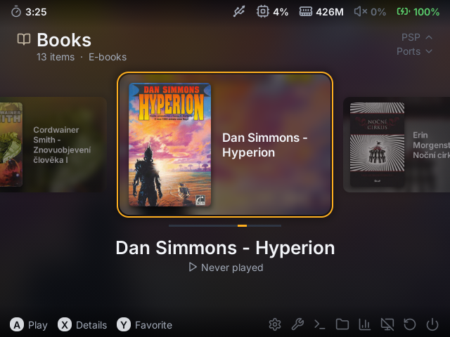
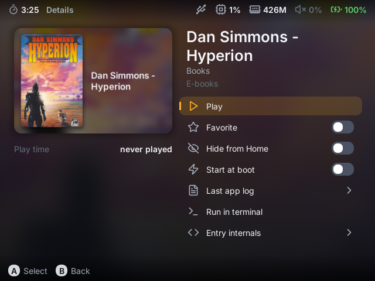
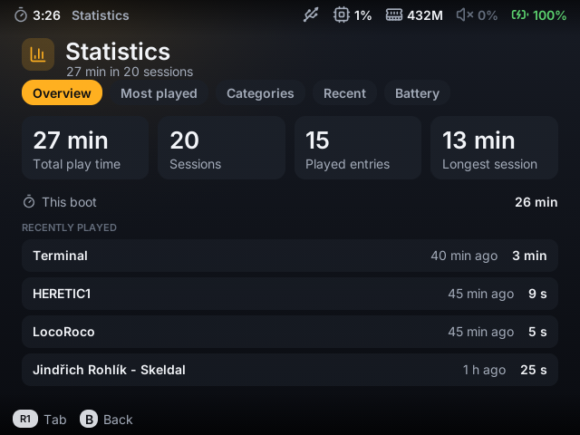
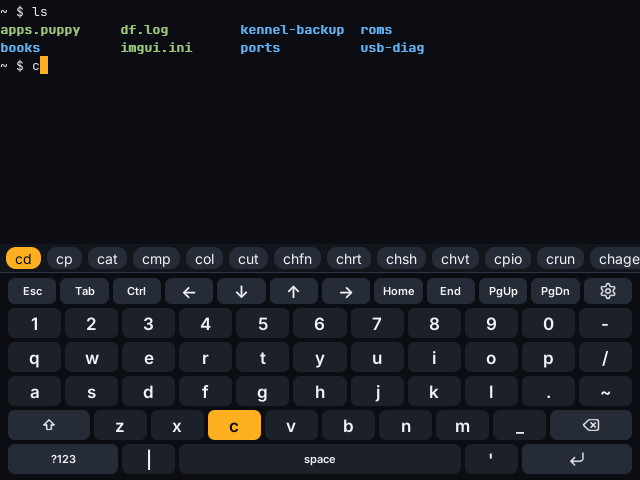

# kennel

A launcher for Linux handhelds with a 640x480 screen and a gamepad, built for the R36S clone
(GA36-MB, Allwinner A23) running [goodluckOS](https://github.com/CodeZombie/goodluckOS). It replaces
goodluckOS's Puppy launcher and reads the same `.puppy` files, so existing entries and ROM folders
keep working.

<p>
 
 
</p>

## What's inside

- **kennel**: one category at a time, a carousel with large cards, game art and book covers,
  play time and last played, favourites, hidden entries, quick settings (brightness, volume,
  output), power actions, a file browser, battery history, backup to the TF card, wallpaper and
  accent colours.
- **Expert mode**: live system status, logs, processes, library diagnostics, sessions, a
  performance overlay.
- **kennel-read**: a small e-book reader for EPUB, FB2, MOBI/PDB, HTML and plain text. Scrolls by
  lines, no images, remembers the position and the reading time. A status bar with chapter, pages,
  progress, reading time and battery. Three reading fonts built in, nine more in an optional pack,
  and your own fonts in `~/.local/share/kennel/fonts`.
- **kennel-term**: a terminal for the gamepad. On-screen keyboard, suggestions from your history,
  PATH and the current folder, and a keys mode for `top`, `less`, `vi` or `alsamixer`.

Everything is C++20 on SDL3. kennel starts in about half a second on the A23 and draws nothing
while idle.

## Install on goodluckOS

1. Download `kennel-glos.zip` from the releases and unzip it into the HOME root of the console
   (over USB: `GA36MB -> HOME`). Optionally unzip `kennel-fonts.zip` the same way for nine more
   reading fonts.
2. In Puppy, start kennel from the System category.
3. In kennel: Settings > Launcher at boot > kennel.

If kennel ever fails to start, the launcher script falls back to Puppy. The same setting switches
back to Puppy.

Books go to `HOME/books` (or `books` on the external card).

## Controls

| Button | Home | Lists |
|---|---|---|
| D-pad, left stick | cards and categories | move |
| A | play | select |
| B | back | back |
| X | details | |
| Y | favourite | |
| L1 / R1 | 5 cards | page |
| L2 / R2 | previous / next letter | |
| START | quick settings | |
| SELECT | dock (settings, files, statistics, power) | |

## Build

Requirements: CMake, Ninja, SDL3, SDL3_ttf, ALSA, zlib; for the console also clang and lld.

```sh
scripts/build.sh host     # run on a PC
scripts/build.sh armhf    # cross build for the console (downloads a Debian armhf sysroot)
scripts/stage-glos.sh     # build/kennel-glos.zip, build/kennel-fonts.zip
```

Running on a PC, testing and the full reference: [docs/REFERENCE.md](docs/REFERENCE.md).
Design notes: [docs/DESIGN.md](docs/DESIGN.md).

## Other systems

Device integration (launch command, power actions, backlight, mixer, library sources) lives in
`platforms/<id>.ini`. Another system needs a profile, not code changes.

## License

MIT, see [LICENSE](LICENSE). Bundled fonts (Inter, JetBrains Mono and the reading fonts in
`assets/fonts/read`, including the optional pack) are under the SIL Open Font License, Lucide icons
under ISC, stb_image and QOI under MIT/public domain.
